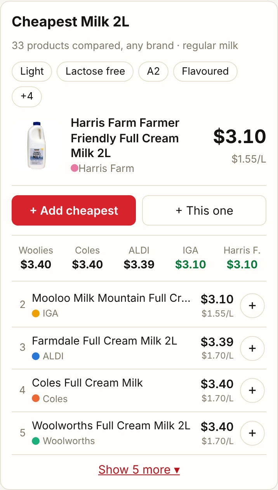
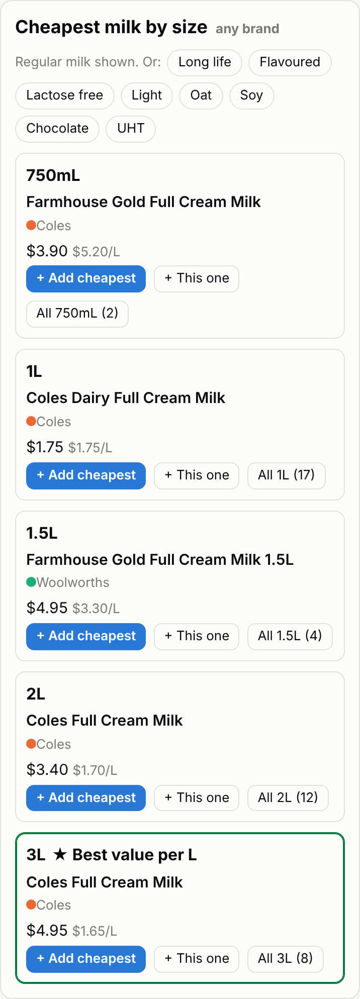
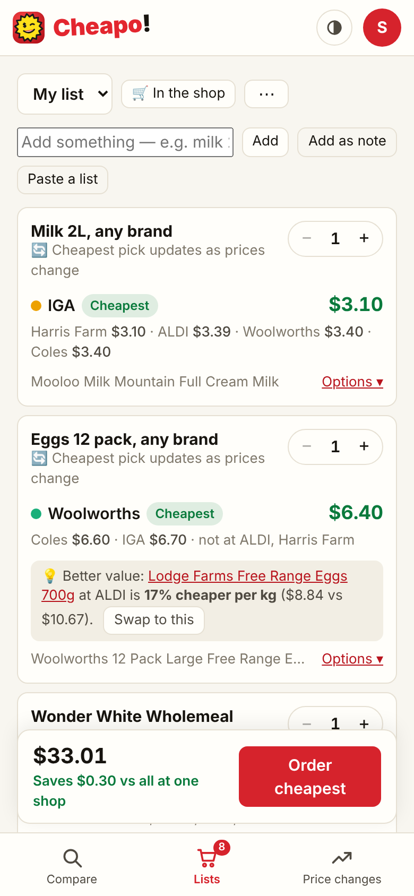
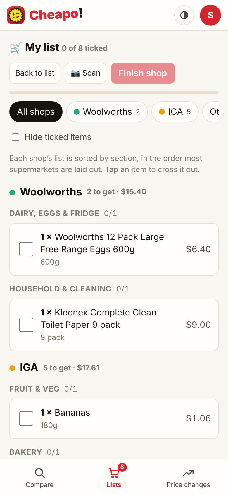

<p align="center"></p>

<h1 align="center">Cheapo</h1>

<p align="center"><strong>The cheapest groceries across Woolworths, Coles, ALDI, IGA and Harris Farm, on one shopping list. Plus Dan Murphy's, BWS and Liquorland, if you want them.</strong></p>

A self-hosted price comparison site for Australian supermarkets. It collects every product and price from each chain daily (about 75,000 products), matches the same item across shops, and keeps a shared shopping list that always knows where each thing is cheapest. Run it for your household on a home server, or host it publicly with accounts.

<p align="center">
  
  
  
  
</p>

## What it does

- **The cheapest of anything, any brand.** Search `milk 2l` and the top result is the cheapest plain 2L milk at your shops, whatever the brand. Search `milk` and you get each common size, with the best value per litre highlighted.
- **A list that follows the prices.** **Add cheapest** puts "the cheapest 2L milk" on your list, and it re-picks at every shop as prices change. Or add an exact product, or a plain note like "birthday card".
- **Where to buy each thing.** The list splits itself across the shops you use, shows what each shop is saving you, and compares the total with doing it all at one shop.
- **In the shop.** A checklist per shop, sorted by section and learning your shop's layout. Tick as you go, scan barcodes, share it with your household, and use it offline.
- **Is it a good price?** Price history for every product, "lowest in 6 months" and "goes on special about every 6 weeks" hints, deals that break the usual cycle, and alerts for things you watch.
- **Counts the real deals.** Multi-buys ("2 for $5") and Everyday Rewards member prices are included in list totals.
- **Runs itself.** Prices refresh every night. Admins get one summary email if a shop's refresh has problems, and helpers (your own PC, or a friend's) share the work and cover shops that block cloud servers.

The full list is in [docs/features.md](docs/features.md).

## Get started

**Docker (any machine):**

```bash
git clone https://github.com/tymondomanko/cheapo.git && cd cheapo
cp .env.example .env        # set ADMIN_EMAILS, and SECURE_COOKIES=false for plain http on your network
docker compose up -d        # http://localhost:3000
```

Sign up with the email in `ADMIN_EMAILS` to become the admin, then go to **Admin → Refresh all prices**. The first refresh takes 30–60 minutes, and after that it runs every night.

**Unraid, a server with your own domain, Fly.io or Render:** see [DEPLOY.md](DEPLOY.md).

**Without Docker** (Node.js 20+):

```bash
npm install
npm run seed:demo                         # optional: demo data to try the site straight away
ADMIN_EMAILS=you@example.com npm start    # http://localhost:3000
```

The image is published to `ghcr.io/tymondomanko/cheapo` on every push to `main`.

## Documentation

| | |
|---|---|
| [DEPLOY.md](DEPLOY.md) | Installing and updating: Docker, Unraid, your own domain, cloud hosts, email, backups, helpers |
| [docs/features.md](docs/features.md) | Everything the site does |
| [docs/configuration.md](docs/configuration.md) | Every setting |
| [docs/how-it-works.md](docs/how-it-works.md) | Where the prices come from, how products are matched, the code layout and adding a supermarket |

## Good to know

- **Unofficial data.** None of the supermarkets has a public API. The site reads the same data their websites load, so a redesign can break a scraper until it's fixed. Each one is a small, self-contained module.
- **Some shops block servers.** Woolworths and ALDI can block cloud servers, and Coles blocks any connection that asks for too much. A home connection works best. The crawlers back off when blocked and carry on later.
- **Online prices.** In-store prices can differ. IGA prices are per store, and you pick yours.
- **Terms of use.** Keep the request pacing polite, and check each supermarket's terms before running it publicly. Republishing scraped prices is a legal grey area.

## License

[MIT](LICENSE)
